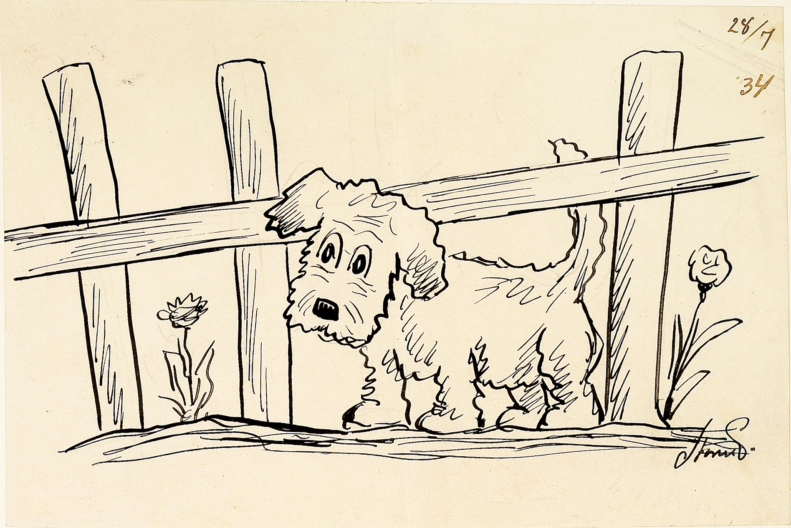

#+options: toc:nil
#+OPTIONS: tags:t timestamp:t todo:t p:t
#+OPTIONS: TeX:t LaTeX:t
#+OPTIONS: skip:t @:t ::t |:t ^:t f:t
#+KEYWORDS: orgmode pdf latex
#+LANGUAGE: en

#+LATEX_CLASS: article
#+LATEX_CLASS_OPTIONS: [a4paper,12pt]

#+LATEX_HEADER: \makeatletter\def\clearwrapfig{\ifnum\c@WF@wrappedlines>\@ne\mbox{}\par\expandafter\clearwrapfig\fi}\makeatother

#+LATEX_HEADER: \usepackage[top=0.5in,bottom=0.5in,left=0.5in,right=0.5in,a4paper]{geometry}
#+LATEX_HEADER: \geometry{verbose}% Just to show settings in the log

# reference
# https://orgmode.org/manual/LaTeX-header-and-sectioning.html

* Foo
#+NAME: fig:top
#+CAPTION: Section intro

Text below [[fig:top]].

#+NAME: fig:left
#+CAPTION: left figure
#+ATTR_LATEX: :float wrap :width 0.38\textwidth :placement {l}{0.4\textwidth}

I must be on the same line as figure [[fig:left]].
#+LATEX: \clearwrapfig

#+NAME: fig:right
#+CAPTION: right figure
#+ATTR_LATEX: :float wrap :width 0.38\textwidth :placement {r}{0.4\textwidth}

I must be on the same line as figure [[fig:right]].
#+LATEX: \clearwrapfig

This is text after the images.
